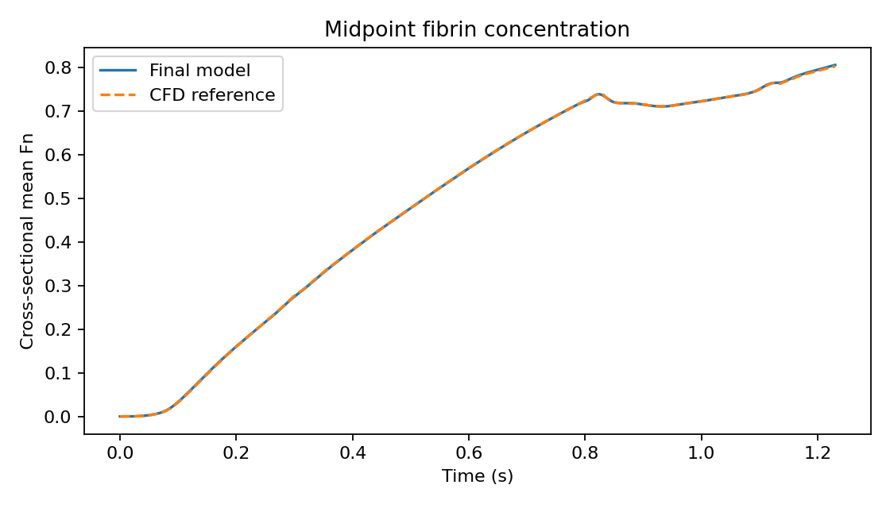
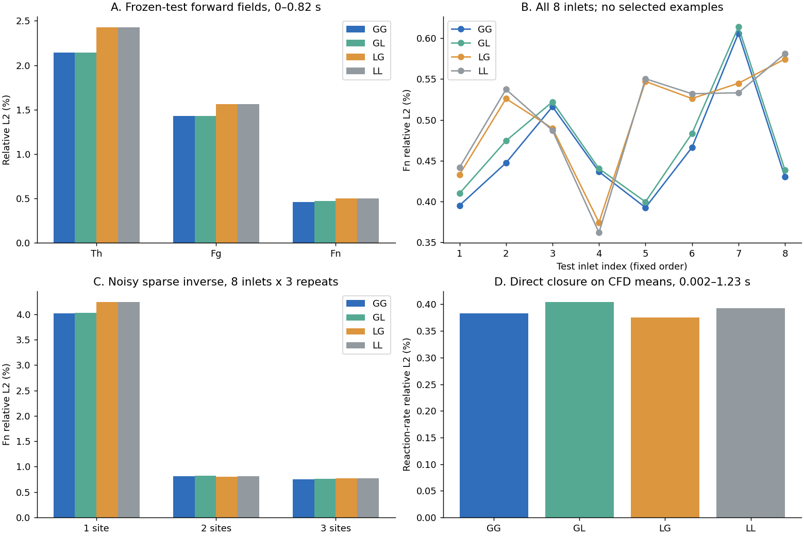

# GP52: Neural closures for 1-D blood flow and coagulation

A reproducible research implementation of **strictly one-dimensional biochemical
transport with learned transport and reaction closures**, driven by reconstructed
blood flow.

The final model combines a graph neural transport closure, a graph neural reaction
closure and a conservative finite-volume solver. It predicts cross-sectional mean
thrombin (Th), fibrinogen (Fg) and fibrin (Fn), and reconstructs an unknown inlet
from sparse Th/Fg observations.

**The main demonstrated benefit is accuracy against a cross-sectionally averaged
CFD reference. The final model has not demonstrated a speed advantage over the
calibrated numerical baseline.**

[Quick start](#quick-start) | [Results](#main-results) |
[Model](docs/ARCHITECTURE.md) | [Data](docs/DATA.md) |
[Reproduction](docs/REPRODUCIBILITY.md) | [License and attribution](THIRD_PARTY_NOTICES.md)

## What this release contains

- The unchanged final transport and reaction checkpoints.
- A standalone Python package for GPU inference and differentiable training.
- A small bundled example requiring no dataset download.
- A calibrated five-parameter numerical closure baseline, C1.
- Equal-parameter graph/pointwise-MLP controls.
- Forward evaluation and the shared 1/2/3-site inverse procedure.
- Downloadable training, development and test labels with SHA-256 checksums.
- Published metrics, figures and packaging-equivalence checks.
- Raw-waveform extraction, independent ALE CFD, blood PIGNN training and complete data regeneration.

This is a **neural-closure/conservative-solver hybrid**. The biochemical networks
predict closure coefficients; the conservation equations advance concentrations.
The research pipeline uses a conservative Sen-inspired blood-flow PIGNN upstream.
The default example loads prepared reconstructed flow arrays. The optional raw-input
workflow fetches the original upstream source separately and regenerates the CFD
inputs and trained project models. See [scope and attribution](THIRD_PARTY_NOTICES.md).

## Requirements

The tested configuration is Linux x86-64, Python 3.10, PyTorch 2.10.0 with CUDA 12.8,
Triton 3.6.0 and an NVIDIA RTX 5090 (32 GB). A working NVIDIA driver is required;
the PyTorch wheel supplies its CUDA runtime libraries.

Inference and the supplied evaluation commands require CUDA. There is no CPU or
macOS inference implementation in this release. Full-batch training was validated
on a 32 GB GPU and used approximately 27 GB in the original ablation runs.
Performance on smaller GPUs has not been established.

## Quick start

~~~bash
git clone https://github.com/woshilry61/gp52-neural-closure.git
cd gp52-neural-closure
python3.10 -m venv --prompt gp52-public .venv
source .venv/bin/activate

python -m pip install --upgrade pip
python -m pip install torch==2.10.0 --index-url https://download.pytorch.org/whl/cu128
python -m pip install -e .

python -m gp52.demo
~~~

The example writes:

~~~text
outputs/demo/
  prediction.npz    # [batch, species, axial cell, time]
  midpoint.csv      # time_s, Th, Fg, Fn at the vessel midpoint
  midpoint.png      # model and CFD midpoint Fn curves
  summary.json      # example errors, conservation and minimum concentration
~~~

The concentration array has shape **(1, 3, 41, 616)**, ordered as **Th, Fg, Fn**.
The time grid spans 0-1.23 s in steps of 0.002 s; the vessel length is 0.06 m.
The default example is the first published test inlet, seed 2026102621.
Its score is an individual-case score, not the eight-inlet mean in the results table.

To use a different inlet, provide seven amplitudes:

~~~bash
python -m gp52.demo --amplitudes 0.2 0.4 0.8 0.6 0.3 0.5 0.4 --output outputs/custom
~~~

They are piecewise-linearly interpolated at
[0, 0.06, 0.14, 0.24, 0.40, 0.60, 0.82] seconds, then held constant to 1.23 s.
The tested inlet range is 0-1.2 in the model's concentration units.
A custom prediction is not accompanied by a CFD accuracy claim.

### Python API

~~~python
import numpy as np
from gp52.inference import get_solver

solver = get_solver("GG")
amplitudes = np.array([[0.2, 0.4, 0.8, 0.6, 0.3, 0.5, 0.4]])
concentration, diagnostics = solver.solve(amplitudes)

# CUDA tensors: concentration [batch, 3, 41, 616]
# diagnostics[:, 0]: normalized maximum mass-balance defect
# diagnostics[:, 1]: minimum concentration encountered
print(concentration.shape)
~~~

The fixed reconstructed blood flow, geometry, initial concentrations and physical
parameters are loaded from the bundled flow asset. The API varies the chemical
inlet. Arbitrary new blood flows or geometries require a new preparation and
validation procedure; changing a filename is not sufficient.

## Main results

Eight test inlets not used for training or model selection; the same vessel and
blood-flow condition are used throughout. Errors are cross-sectional-area and
trapezoidal-time weighted relative L2 errors, computed per inlet and then averaged.
CFD is an independent numerical reference with its own discretization error.

### Known-inlet forward prediction

| Method | Th, 0-0.82 s | Fg, 0-0.82 s | Fn, 0-0.82 s | Fn, 0-1.23 s |
|---|---:|---:|---:|---:|
| Calibrated numerical closure C1 | 4.936% | 1.916% | 1.820% | 1.432% |
| Learned transport only | 2.143% | 1.433% | 0.574% | 0.522% |
| Learned transport + polynomial reaction | 2.143% | 1.432% | 0.517% | 0.464% |
| **Final graph transport + graph reaction** | **2.143%** | **1.429%** | **0.461%** | **0.412%** |

C1 includes four calibrated transport corrections and one reaction correction.
It was selected on development data and checked with four additional optimization
starts, which converged to essentially the same parameters. The comparison is
against that frozen calibrated baseline.

The main-window Fn error is approximately 75% lower than C1. Adding the reaction
graph to the learned transport model lowers Fn error by a further 19.6%.
Direct full-window physical reaction-rate error decreases from 0.533% for the
mean-product closure to 0.383% for the final reaction closure.

### Sparse inverse prediction of unobserved Fn

Only Th and Fg are observed; Fn is never an online measurement. Each site has
24 observation times through 0.82 s. The unknown inlet has seven amplitudes.
The neural weights remain frozen during inversion.

| Sites | Observation noise | C1 Fn, 0-0.82 s | Final Fn, 0-0.82 s |
|---|---|---:|---:|
| 1 | None | 4.563% | 1.816% |
| 1 | Standard deviation 0.02 | 4.585% | 4.021% |
| 2 | None | 1.788% | 0.679% |
| 2 | Standard deviation 0.02 | 1.782% | 0.809% |
| 3 | None | 1.795% | 0.653% |
| 3 | Standard deviation 0.02 | 1.803% | 0.746% |

Locations are 30 mm; 6/30 mm; and 6/30/54 mm from the inlet. Noisy results average
three independent noise realizations per inlet. These are still eight independent
inlets, not 24.

The one-site noisy full-window Fn error is **12.717%**, compared with C1's
**12.630%**. Recovering the inlet and extrapolating beyond the observation window
remain weak in this case. See [all main results](docs/RESULTS.md).

### Equal-parameter graph ablation

| Variant | Transport head | Reaction head | Biochemical parameters | Fn, 0-0.82 s |
|---|---|---|---:|---:|
| GG (final) | Graph | Graph | 9,125 | 0.461% |
| GL | Graph | Pointwise MLP | 9,125 | 0.473% |
| LG | Pointwise MLP | Graph | 9,125 | 0.502% |
| LL | Pointwise MLP | Pointwise MLP | 9,125 | 0.503% |

All variants retain the same physical gradient/history features and conservative
spatial coupling. "Pointwise" removes learned neighbor aggregation, not all spatial
information. The graph mean Fn advantage over LL is modest; the paired inlet
bootstrap interval includes zero. One training initialization was used per
architecture. This supplementary ablation reused the existing test set and is not
a new independent blind test.

### Runtime

The original matched RTX 5090 warm benchmark for eight complete trajectories was
44.92 ms for C1 and 48.72 ms for the final graph model. Fixed-flow coefficients were
precomputed, and training was excluded. These are historical benchmark records,
not guaranteed timings for another GPU or software configuration.

## Reproduce evaluation

Download the 16.5 MB test-label asset and verify its checksum:

~~~bash
python scripts/download_data.py --split test
python -m gp52.evaluate --methods C1 GG --inverse --verify-reference
~~~

This independently reruns forward predictions and all 1/2/3-site inverse
optimizations, including three starts and the same bounded refinement procedure.
It writes full prediction arrays and outputs/evaluation/metrics.json.
It does not merely display saved scores.

To include all graph/MLP variants:

~~~bash
python -m gp52.evaluate --methods C1 GG GL LG LL --inverse --verify-reference --output outputs/ablation
~~~

To check the original archived forward arrays as well:

~~~bash
python scripts/download_data.py --split reference-forward
python -m gp52.verify
~~~

See [reproducibility details](docs/REPRODUCIBILITY.md) for expected tolerances,
artifact hashes, environment checks and training commands.

## Retrain the biochemical closures

### Complete train-to-evaluation workflow

After installation, run the entire biochemical reproduction with one command:

~~~bash
python scripts/retrain_and_evaluate.py --output runs/from-scratch
~~~

Choose a new output directory for each run. This command:

1. Downloads and verifies only the training and development partitions.
2. Initializes a fresh graph transport head and trains it for 1,500 loop steps.
3. Initializes a fresh graph reaction head for each of the three source-loss
   weights (0.03, 0.3 and 3), using the newly trained, frozen transport head.
4. Selects the reaction checkpoint using development data only.
5. Downloads the test partition after selection.
6. Evaluates the calibrated numerical baseline, the unchanged published model,
   and the newly trained model on all forward and 1/2/3-site inverse cases.
7. Verifies the identity of the weights actually loaded for evaluation and checks
   that every distributed model/data asset remains unchanged.

The run saves stage logs, training histories, new checkpoints, full prediction
arrays, environment information, and a comparison with the published model:

~~~text
runs/from-scratch/
  pipeline.json
  logs/
  transport/runs/graph/best.pt
  reaction/reaction.pt
  reaction/selected.json
  evaluation/metrics.json
  comparison.json
~~~

The published weights are never used to initialize either trained head. The
initial output layers are zero-initialized, with fresh random hidden layers, as
in the original procedure. Fixed prepared blood-flow arrays, numerical operators
and prescribed physical parameters are reused. This is biochemical retraining;
it does not retrain Sen's blood-flow network or regenerate the CFD reference.

The acceptance comparison is declared before training: the largest absolute
change in any per-inlet forward or inverse concentration error, and the reported
mean direct reaction-rate error, must be at most 0.0005 in relative-L2 units
(0.05 percentage points). The report separately records whether the tighter
1e-8 frozen-evaluation tolerance is met. These comparisons do not select or
modify the trained checkpoints.

To evaluate existing new checkpoints without retraining:

~~~bash
GP52_DATA_DIR=runs/from-scratch/data python -m gp52.evaluate --methods C1 GG retrained --inverse --verify-reference \
  --transport-weights runs/from-scratch/transport/runs/graph/best.pt \
  --reaction-weights runs/from-scratch/reaction/reaction.pt \
  --output outputs/retrained-evaluation
~~~

Here GG always means the unchanged published model; retrained always uses both
explicitly supplied checkpoints. The reference check applies to the published
methods, while comparison.json assesses the newly trained model. Test data must
be available in data/ or in the directory specified by GP52_DATA_DIR.

The independent full run completed in **11.52 minutes**. Its
retrained parameter tensors matched the published model: **true**.
The largest compared metric difference was **0** in relative-L2 units.
See [the full retraining validation](docs/RETRAINING.md) for measured GPU use,
all results, new checkpoints and reproducibility limits.

### Individual training stages

~~~bash
python scripts/download_data.py --split all
python -m gp52.train_transport --kind graph --steps 1500 --output runs/retrained-transport

for weight in 0.03 0.3 3; do
  python -m gp52.train_reaction --kind graph --weight "$weight" --steps 500 --source-steps 1000 \
    --transport-weights runs/retrained-transport/runs/graph/best.pt \
    --output runs/retrained-reaction
done

python scripts/select_reaction.py --run-directory runs/retrained-reaction --kind graph
~~~

Training uses 16 inlet trajectories; eight separate development trajectories
select checkpoints and the source-loss weight. Test labels are not loaded by the
training commands. The transport stage uses 1,505 actual optimizer updates;
each default reaction candidate uses 1,003 source-fitting and 503 trajectory updates,
including warm-up updates. The training implementation uses CUDA Graphs and
full-trajectory batches.

Retraining writes only to the requested run directories. It never replaces the
distributed checkpoints. Exact retraining results can depend on the software and
GPU environment; numerical equivalence of the frozen published model is checked
separately.

To use newly trained weights:

~~~python
from gp52.inference import Solver
model = Solver(
    "GG",
    weights="runs/retrained-reaction/reaction.pt",
    transport_weights="runs/retrained-transport/runs/graph/best.pt",
)
~~~

## Rebuild from raw input

To regenerate the blood reconstruction and CFD datasets as well as train the
biochemical networks, install the additional finite-element dependency and run:

~~~bash
python -m pip install -r requirements-raw.txt
python scripts/reproduce_raw.py --output runs/from-raw
~~~

This fetches Sen's pinned original repository, extracts its raw waveform, computes
independent CFD, trains the project's conservative blood PIGNN, generates all
32 chemical cases, and trains/evaluates the final biochemical model. Generated
inputs and new weights stay in the run directory.

The blood model is the project's PyTorch adaptation of Sen's graph architecture.
The unchanged original TensorFlow experiment is not a dependency of the final
model. Geometry, physical constants, numerical closure coefficients and inverse
regularization remain declared experiment settings.

The independently verified run completed in **31.91 minutes**. All regenerated
dataset and solver-input arrays matched the release exactly; both newly trained
biochemical heads had identical parameter tensors, and every compared forward,
inverse and direct-rate metric had difference **0**. Original assets were unchanged.

See [raw-input reproduction](docs/RAW_REPRODUCTION.md) for the full dependency
chain, commands, measured results and the distinction between generated inputs
and fixed configuration.

## Repository layout

~~~text
src/gp52/
  assets/           fixed-flow input, example, frozen weights, split/solver settings
  networks.py       graph and equal-parameter pointwise heads
  transport.py      differentiable conservative transport and flux memory
  reaction.py       reaction features, source multiplier, predictor-corrector
  predictor.py      sequential Triton transport predictor
  corrector.py      sequential Triton reaction corrector
  baseline.py       calibrated numerical C1 implementation
  inference.py      frozen forward-model API
  inverse.py        shared sparse inlet reconstruction
  data.py           datasets and weighted error metric
  train_*.py        transport and reaction training
  evaluate.py       forward and sparse-inverse experiments
  verify.py         packaging equivalence and physical checks
  raw/              waveform extraction, ALE CFD, blood training and data preparation
scripts/            downloads, complete reproduction drivers and checkpoint selection
data/manifest.json  checksums of release data assets
benchmarks/         machine-readable published and reproduced results
docs/               architecture, provenance, results and figures
~~~

## Validated scope and limitations

- Strict cross-sectional 1-D concentrations; two memory channels are temporal
  flux variables, not radial concentration subdivisions.
- Fixed idealized geometry and blood flow; testing varies chemical inlet curves.
- Simplified Th-catalysed Fg-to-Fn reaction; Fn is immobile and coagulation does not
  feed back onto blood flow.
- The upstream concentration boundary stays connected to a reservoir. The older
  flow-direction-switching inlet condition is not a validated feature here.
- Diffusivity 2e-4 m2/s and the reaction coefficient are numerical verification
  settings, not clinically calibrated protein kinetics.
- CFD and reduced-model discretization errors remain in the comparison. Spatial
  refinement on earlier cases is not a complete convergence study for every
  released test inlet.
- The method improves a particular calibrated closure baseline. The same learned
  closure inserted into an equivalent numerical solver gives the same physical
  prediction; the neural contribution is closure learning.
- One-site noisy inference and new-flow/new-geometry transfer remain unresolved.

## License, citation and support

Project-authored release materials are distributed under the [MIT license](LICENSE).
External works retain their own terms; read [THIRD_PARTY_NOTICES.md](THIRD_PARTY_NOTICES.md).
The unlicensed upstream source, original waveform files, course booklet and paper
PDFs are not redistributed.

Use [CITATION.cff](CITATION.cff) to cite the software, and cite Sen et al. (2024) and
the modelling references listed in the attribution file. Report reproducibility
issues through [GitHub Issues](https://github.com/woshilry61/gp52-neural-closure/issues),
including the command, package versions, GPU and the generated diagnostic output.
