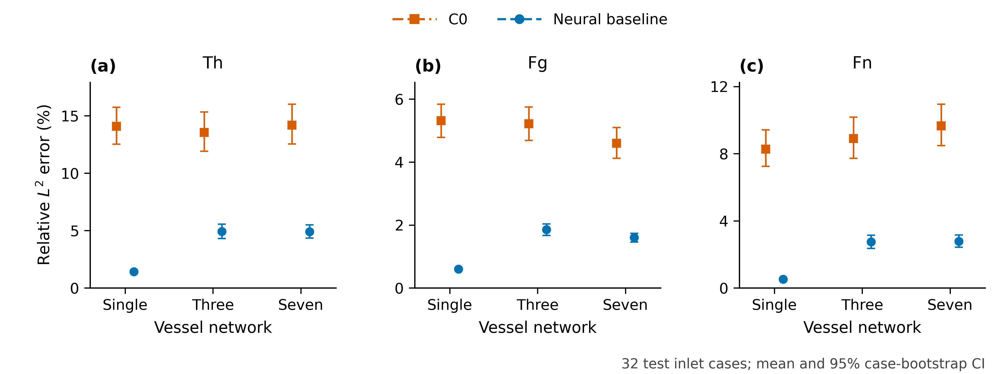
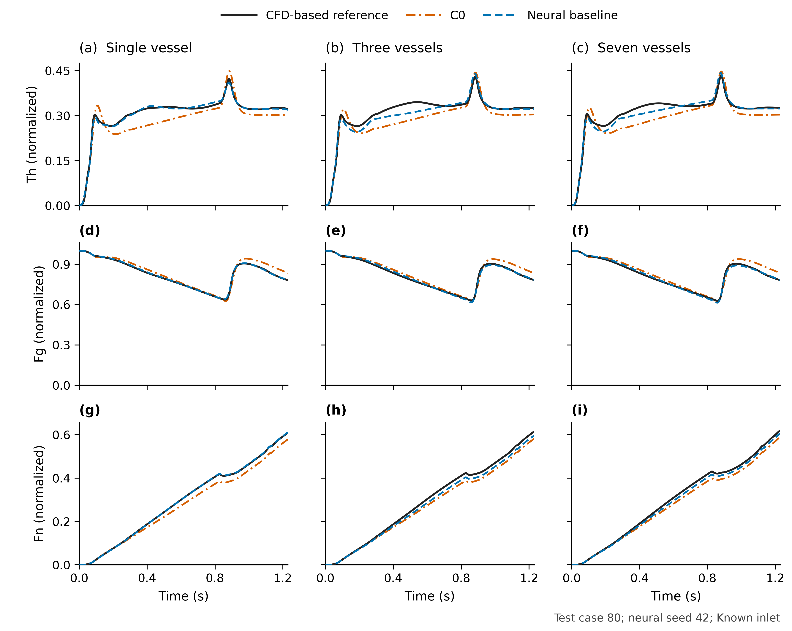

# GP52: Neural closures for one-dimensional coagulation transport

This project predicts **thrombin (Th), fibrinogen (Fg) and fibrin (Fn)** in one-, three- and seven-vessel networks. A conservative one-dimensional solver advances the concentrations. Two graph neural modules learn corrections for transport and reaction information lost by cross-sectional averaging.

The current experiment is **unified-cfd-baselines-v1**. It uses independently computed CFD blood, a common 64/16/32 split of chemical inlet cases, three training seeds per topology, and the fixed conventional finite-volume baseline **C0**. Each topology has its own trained weights.

[Model and equations](docs/CURRENT_MODEL.md) · [Reproduction](docs/UNIFIED_REPRODUCTION.md) · [Full results](reports/unified-cfd-baselines-v1/REPORT.md) · [Historical single-vessel C1 release](docs/LEGACY_SINGLE_VESSEL.md)

## Current results

The independent CFD-based biochemical simulation is a numerical reference, not experimental ground truth. The neural model has lower mean errors than C0 under this fixed-flow benchmark. This does not establish superiority over every calibrated numerical closure or a runtime advantage.

### Known-inlet prediction

Whole-network relative L2 errors over 0–1.23 s, averaged over 32 test inlets. Neural entries average the errors of seeds 42, 43 and 44, not predictions from an ensemble.

| Network | Method | Th | Fg | Fn |
|---|---|---:|---:|---:|
| Single | C0 | 14.09% | 5.31% | 8.27% |
| Single | Neural baseline | 1.41% | 0.60% | 0.52% |
| Three | C0 | 13.56% | 5.22% | 8.90% |
| Three | Neural baseline | 4.92% | 1.85% | 2.74% |
| Seven | C0 | 14.19% | 4.60% | 9.65% |
| Seven | Neural baseline | 4.91% | 1.60% | 2.78% |

### Three-site inverse reconstruction with noise

Only Th and Fg are observed. Seven inlet amplitudes are fitted while all neural weights remain frozen. Inlet error uses 0–0.82 s; concentration errors use 0–1.23 s.

| Network | Method | Inlet | Th | Fg | Fn |
|---|---|---:|---:|---:|---:|
| Single | C0 | 15.08% | 8.41% | 3.40% | 4.24% |
| Single | Neural baseline | 4.14% | 1.87% | 0.60% | 0.78% |
| Three | C0 | 39.37% | 14.89% | 3.74% | 10.00% |
| Three | Neural baseline | 24.25% | 7.24% | 1.60% | 4.05% |
| Seven | C0 | 40.43% | 15.25% | 3.21% | 10.71% |
| Seven | Neural baseline | 23.91% | 6.94% | 1.40% | 4.23% |

The full report includes one-, two- and three-site results, clean and noisy measurements, Th/Fg/Fn errors, per-case data and paired uncertainty intervals. Noise realizations and training seeds are not counted as additional independent test cases.

The trajectory example is the first declared test case (ID 80) and seed 42. Population tables use all 32 cases.

## Install

The validated environment is Linux, Python 3.10, PyTorch 2.10.0/CUDA 12.8 and an RTX 5090 with 32 GB VRAM. Training can approach 30 GiB. CPU-only biochemical inference is not provided. Independent finite-element blood CFD uses CPU sparse solves; biochemical reference generation, neural training and batched inverse rollouts use CUDA.

~~~bash
git clone https://github.com/woshilry61/gp52-neural-closure.git
cd gp52-neural-closure
python3.10 -m venv --prompt gp52 .venv
source .venv/bin/activate
python -m pip install --upgrade pip
python -m pip install torch==2.10.0 --index-url https://download.pytorch.org/whl/cu128
python -m pip install -e .
python -m pip install -r requirements-raw.txt
~~~

## Replay the current frozen models

The three release archives contain generated CFD/biochemical inputs, all 112 inlet cases, and the unchanged selected checkpoints. They total approximately 2.24 GB. The seven-vessel archive is split into smaller downloads and reassembled automatically. Checksums are in [the asset manifest](data/unified-manifest.json). Use a new output directory.

~~~bash
python scripts/download_unified.py --output runs/unified-replay
export GP52_UNIFIED_RUN="$PWD/runs/unified-replay"
python -m gp52.unified.run --stage evaluate
python -m gp52.unified.paper_figures
~~~

This runs C0 and all three neural seeds, selects inverse regularization on validation cases, and reruns forward prediction plus every one-/two-/three-site inverse fit. Results go to `$GP52_UNIFIED_RUN/report/`. The versioned report in this repository stays unchanged.

For a shorter first check, evaluate the single-vessel forward model:

~~~bash
python -m gp52.unified.evaluate single --kind new --seed 42 --stage forward
~~~

## Train again or regenerate the reference

To initialize fresh biochemical weights using the released independent CFD labels:

~~~bash
python scripts/download_unified.py --output runs/unified-retrained --mode retrain
export GP52_UNIFIED_RUN="$PWD/runs/unified-retrained"
python -m gp52.unified.run --stage train
python -m gp52.unified.run --stage evaluate
~~~

To regenerate blood CFD and biochemical labels before training:

~~~bash
export GP52_UNIFIED_RUN="$PWD/runs/unified-from-raw"
python -m gp52.unified.run
~~~

The raw workflow fetches Sen's pinned original repository directly. It does not redistribute that upstream source or use Sen's neural blood predictions as the current reference. See the [reproduction guide](docs/UNIFIED_REPRODUCTION.md) for stage boundaries, data shapes and validation scope.

## Data, model and comparison

- The same 112 seven-knot Th inlet curves are used in all three topologies: 64 training, 16 validation, 32 test. A whole network trajectory belongs to one split.
- There is one independent blood condition per topology. Testing changes chemical inlet curves, not patients or blood-flow conditions.
- Reference chemistry resolves the vessel cross-section. The candidate C0 and neural models retain strictly one-dimensional concentrations.
- Th catalyses Fg conversion into immobile Fn. Fn does not alter the blood flow in this experiment.
- C0 has molecular diffusion and the mean-product reaction, without learned or fitted closure corrections.
- Both candidates receive the same transferred blood fields, observation sites, noise and inverse fitting rules within a topology.

## What remains unresolved

Inlet recovery remains substantially harder than Fn prediction in branched networks. Additional downstream sites give modest neural gains. Residual transport errors remain, and transfer to unseen blood flows or geometries has not been established. The seven-vessel blood mesh needs a fuller convergence study. The historical equal-parameter graph ablation concerns the earlier single-vessel experiment, not these newly trained three-topology models.

The neural contribution is learning closure information. Inserting identical learned closures into an equivalent numerical solver gives identical physics predictions. There is no demonstrated speed advantage in this release.

## Reports and presentation

- [Complete English report](reports/unified-cfd-baselines-v1/REPORT.md)
- [Machine-readable summary](reports/unified-cfd-baselines-v1/summary.csv) and [per-case errors](reports/unified-cfd-baselines-v1/per-case-errors.csv)
- [Publication figures and captions](reports/unified-cfd-baselines-v1/paper-figures/README.md)
- [20-slide group presentation](docs/presentation/GP52_Group_Update.pptx) and [PDF](docs/presentation/GP52_Group_Update.pdf)
- [Release validation](docs/RELEASE_VALIDATION.md)
- [Earlier single-vessel release and C1 comparison](docs/LEGACY_SINGLE_VESSEL.md)

The old `python -m gp52.demo`, `gp52.evaluate` and `scripts/reproduce_raw.py` interfaces remain available for that historical single-vessel release. Use `gp52.unified` for the current experiment.

## License and attribution

Project-authored materials use the [MIT license](LICENSE). External works retain their own terms. Read [third-party attribution](THIRD_PARTY_NOTICES.md) and [CITATION.cff](CITATION.cff). No upstream source tree, original waveform archive, course booklet or paper PDF is redistributed.
