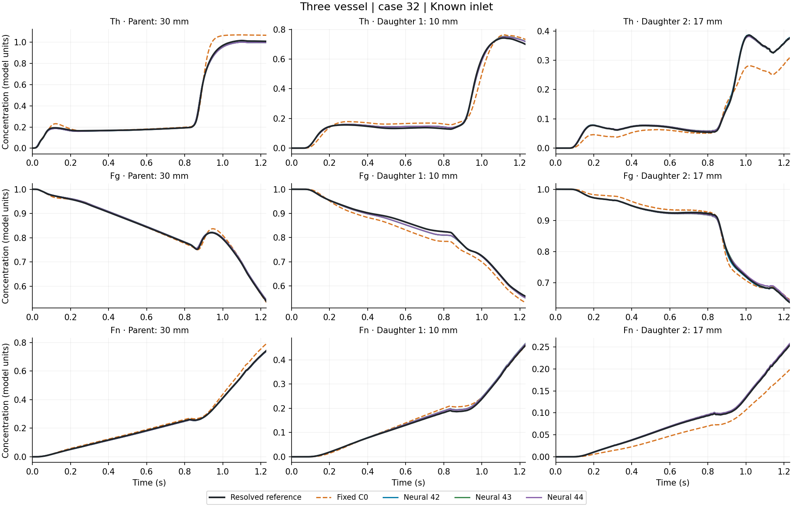
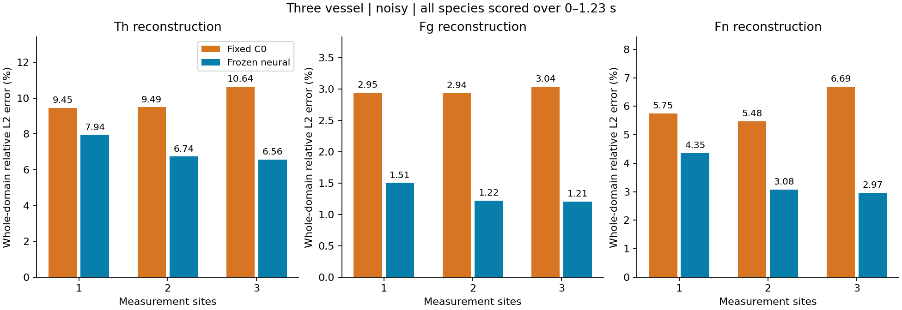
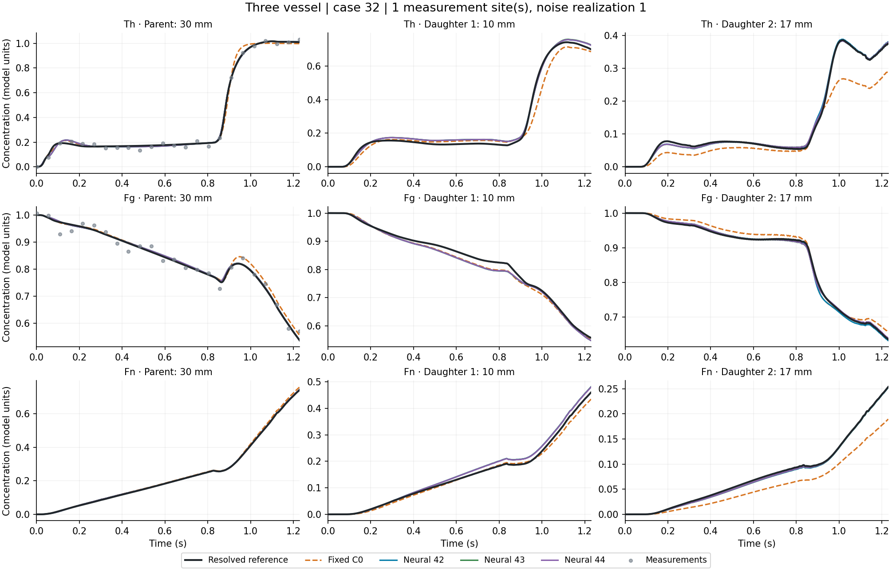
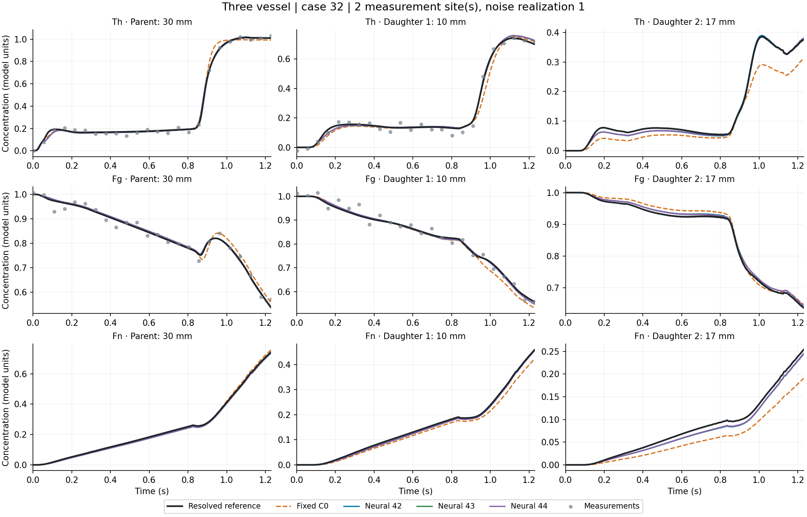
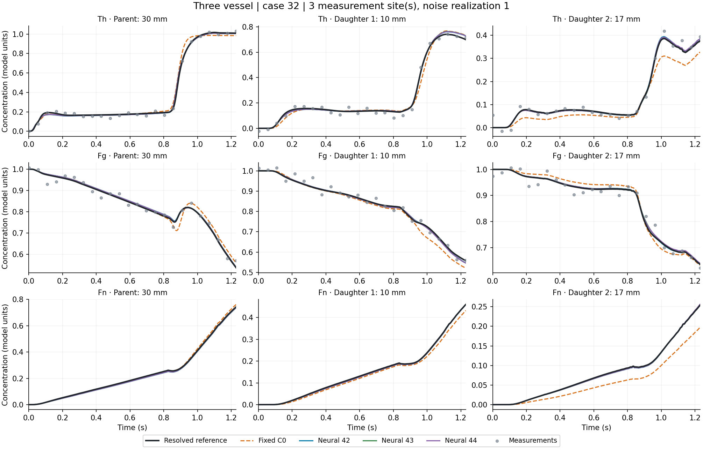
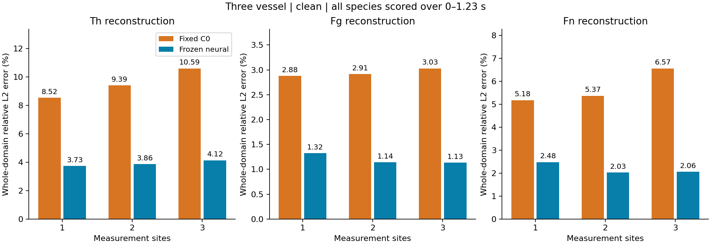
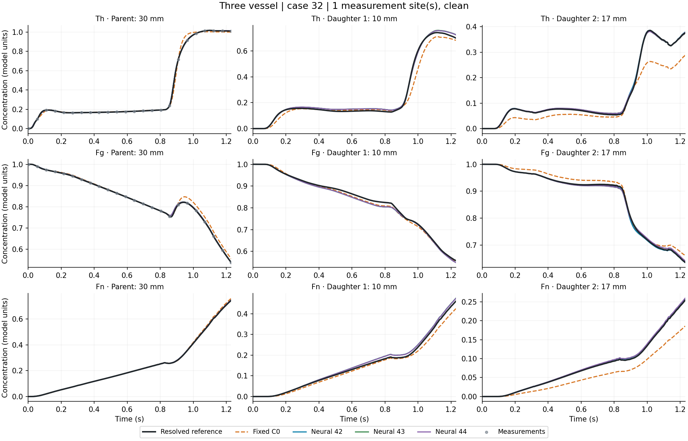
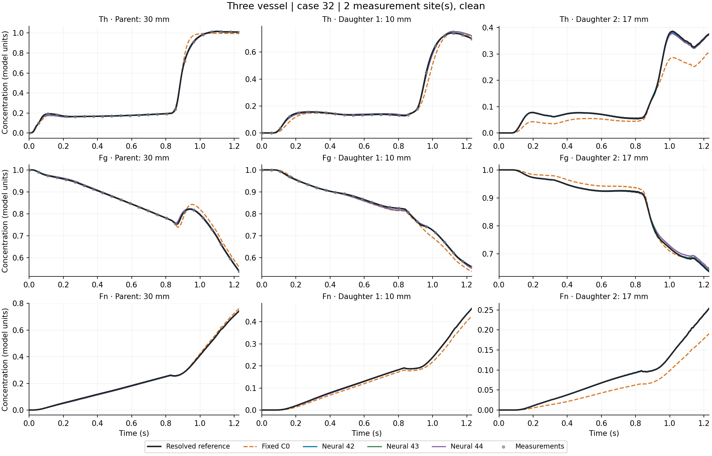
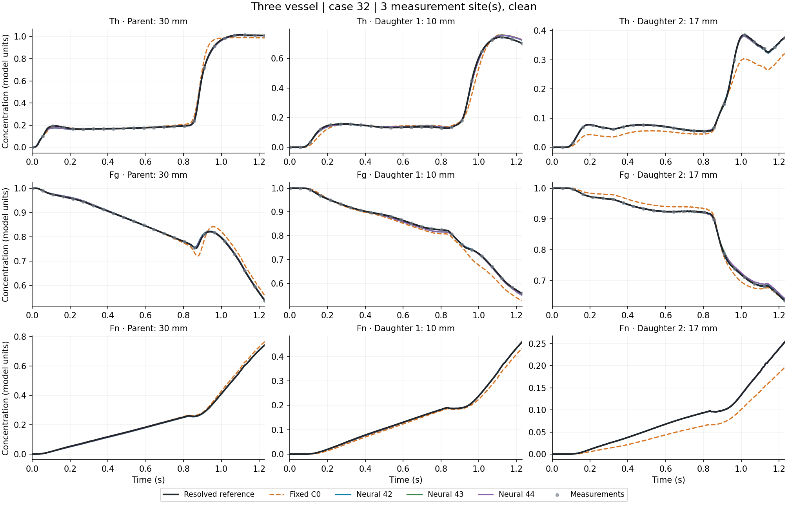

# Three-vessel Th, Fg and Fn: fixed C0 comparison

This report completes the concentration display for the existing frozen models. It adds full-window Th and Fg scores to the previously reported Fn and inlet scores. Existing inverse fits, regularization choices, weights, C0 equations and historical reports are unchanged.

**Open [the complete concentration viewer](curves.html)** to choose any test inlet, known-inlet prediction or one/two/three-site inversion, and clean or any of the three noisy realizations. All three species and three spatial locations are shown together.

## Reading the results

- Known-inlet forward prediction: supply the true Th inlet and compare all predicted concentration fields with the resolved reference.
- Sparse inverse reconstruction: fit the seven Th inlet amplitudes to Th/Fg observations, then assess all reconstructed fields. Fn is never supplied as an observation.
- Th, Fg and Fn errors use the full 0–1.23 s interval and every cell, with shared cell-volume weights and equal time-sample weights. The inset curves show specific locations; the error tables score the whole domain.
- Inlet recovery retains 0–0.82 s. Observations are the same 24 times from 0.002 to 1.23 s. The final inlet amplitude is held after 0.82 s.
- There are 16 existing held-out inlet cases. Noisy results average three Gaussian realizations per case, with absolute standard deviation 0.02. The two candidate families receive the same arrays.
- Concentrations use the existing model units, not calibrated clinical concentration measurements.

Three-vessel neural means average errors from frozen seeds 42, 43 and 44. They are not errors of an ensemble prediction. All seeds remain visible in the curve viewer and the per-method CSV tables. Sites are the parent midpoint (30 mm), then daughter 1 midpoint (10 mm), then daughter 2 midpoint (17 mm).

The reference resolves axial and radial concentration variation in each tube with a prescribed blood field and a perfectly mixed junction. It is not a full three-dimensional Navier–Stokes bifurcation simulation.

## Known-inlet forward prediction

| Method | Th | Fg | Fn |
|---|---:|---:|---:|
| Fixed C0 | 9.43% | 3.91% | 5.77% |
| Neural 42 | 2.81% | 1.29% | 2.07% |
| Neural 43 | 2.83% | 1.30% | 2.10% |
| Neural 44 | 2.81% | 1.29% | 2.08% |
| Neural mean (individual errors) | 2.82% | 1.29% | 2.08% |

## Noisy inverse reconstruction

| Sites | C0 Th | Neural Th | C0 Fg | Neural Fg | C0 Fn | Neural Fn |
|---:|---:|---:|---:|---:|---:|---:|
| 1 | 9.45% | 7.94% | 2.95% | 1.51% | 5.75% | 4.35% |
| 2 | 9.49% | 6.74% | 2.94% | 1.22% | 5.48% | 3.08% |
| 3 | 10.64% | 6.56% | 3.04% | 1.21% | 6.69% | 2.97% |

| Sites | C0 inlet, 0–0.82 s | Neural inlet, 0–0.82 s |
|---:|---:|---:|
| 1 | 27.33% | 29.99% |
| 2 | 30.41% | 26.94% |
| 3 | 34.33% | 25.95% |

### 1 measurement site(s)

### 2 measurement site(s)

### 3 measurement site(s)

## Clean inverse reconstruction

| Sites | C0 Th | Neural Th | C0 Fg | Neural Fg | C0 Fn | Neural Fn |
|---:|---:|---:|---:|---:|---:|---:|
| 1 | 8.52% | 3.73% | 2.88% | 1.32% | 5.18% | 2.48% |
| 2 | 9.39% | 3.86% | 2.91% | 1.14% | 5.37% | 2.03% |
| 3 | 10.59% | 4.12% | 3.03% | 1.13% | 6.57% | 2.06% |

| Sites | C0 inlet, 0–0.82 s | Neural inlet, 0–0.82 s |
|---:|---:|---:|
| 1 | 23.92% | 8.22% |
| 2 | 30.40% | 12.91% |
| 3 | 34.53% | 14.28% |

### 1 measurement site(s)

### 2 measurement site(s)

### 3 measurement site(s)

The figures above use the first test case by index and, for noisy figures, realization 1. They were not selected for the largest neural gain. The viewer includes every test case and all noise realizations. Gray dots are the observations used at the plotted site; panels without dots show unobserved locations/species.

## Noisy errors in each vessel

| Vessel | Sites | C0 Th | Neural Th | C0 Fg | Neural Fg | C0 Fn | Neural Fn |
|---|---:|---:|---:|---:|---:|---:|---:|
| parent | 1 | 8.69% | 8.03% | 2.68% | 1.07% | 4.19% | 4.12% |
| parent | 2 | 9.35% | 6.92% | 2.81% | 0.94% | 4.54% | 2.94% |
| parent | 3 | 10.77% | 6.73% | 2.95% | 0.93% | 6.11% | 2.82% |
| daughter1 | 1 | 12.35% | 7.62% | 3.58% | 2.72% | 11.33% | 6.58% |
| daughter1 | 2 | 8.84% | 5.56% | 3.34% | 2.09% | 7.93% | 4.33% |
| daughter1 | 3 | 8.36% | 5.56% | 3.41% | 2.07% | 7.02% | 4.28% |
| daughter2 | 1 | 15.17% | 4.27% | 3.45% | 1.04% | 21.52% | 4.04% |
| daughter2 | 2 | 12.31% | 2.87% | 3.02% | 0.80% | 18.83% | 2.73% |
| daughter2 | 3 | 11.41% | 2.62% | 2.88% | 0.73% | 18.09% | 2.46% |

## Paired uncertainty and interpretation

Paired 95% bootstrap intervals resample independent inlet cases after averaging the noise realizations and, for the three-vessel experiment, individual seed errors. Noise realizations and training seeds are not counted as extra independent test inlets.

| Sites | Species | Neural minus C0 | 95% interval | Cases favoring neural |
|---:|---|---:|---|---:|
| 1 | Th | -1.51 pp | [-2.34, -0.68] pp | 12/16 |
| 1 | Fg | -1.44 pp | [-1.70, -1.19] pp | 16/16 |
| 1 | Fn | -1.39 pp | [-2.07, -0.69] pp | 13/16 |
| 2 | Th | -2.75 pp | [-3.88, -1.74] pp | 15/16 |
| 2 | Fg | -1.71 pp | [-1.91, -1.52] pp | 16/16 |
| 2 | Fn | -2.39 pp | [-3.04, -1.81] pp | 16/16 |
| 3 | Th | -4.08 pp | [-5.58, -2.65] pp | 15/16 |
| 3 | Fg | -1.83 pp | [-2.01, -1.67] pp | 16/16 |
| 3 | Fn | -3.72 pp | [-5.14, -2.43] pp | 16/16 |

Species errors have different reference norms. In particular, Fg is initialized at 1 and continuously supplied at boundaries, so a small relative Fg concentration error should not be equated directly with a small error in Fg consumption or reaction rate.

The inverse results are offline reconstruction using the full observation interval. They do not demonstrate prediction before those observations are available. All comparisons are conditional on the existing blood field and geometry, against the fixed basic C0 baseline. They are not new blind tests or comparisons against every calibrated numerical closure.

## Preservation and reproducibility

All 190 protected original files, including existing reports, method locks, weights and saved inverse arrays, passed before/after SHA256 equality. The old inlet and Fn metrics were recomputed and checked to within 1e-12. All newly added species scores use the same prediction arrays and spatial/time weights.

Only known-inlet forward replay uses the GPU. No neural training, inverse optimization or regularization retuning is performed. Both C0 and neural known-inlet replays use the unchanged frozen implementations.

From this repository root and its existing isolated environment:

    .venv/bin/python scripts/report_all_species.py --network three

- [All inverse summary rows](inverse-summary.csv)
- [Per-case inverse errors, including per-vessel rows](inverse-per-case.csv)
- [Known-inlet forward summary](forward-summary.csv)
- [Known-inlet per-case errors](forward-per-case.csv)
- [Paired case bootstrap intervals](paired.csv)
- [Fixed reporting protocol](protocol.json)
- [Replay verification](replay-checks.json)
- [Preservation verification](integrity.json)

Full-resolution float64 point curves, with case/method/species/site labels, are retained in runs/all-species-v3/all-concentration-curves.npz. The standalone HTML embeds the same sampled curves as float32 for display only. Plotting precision does not change any reported metric.
