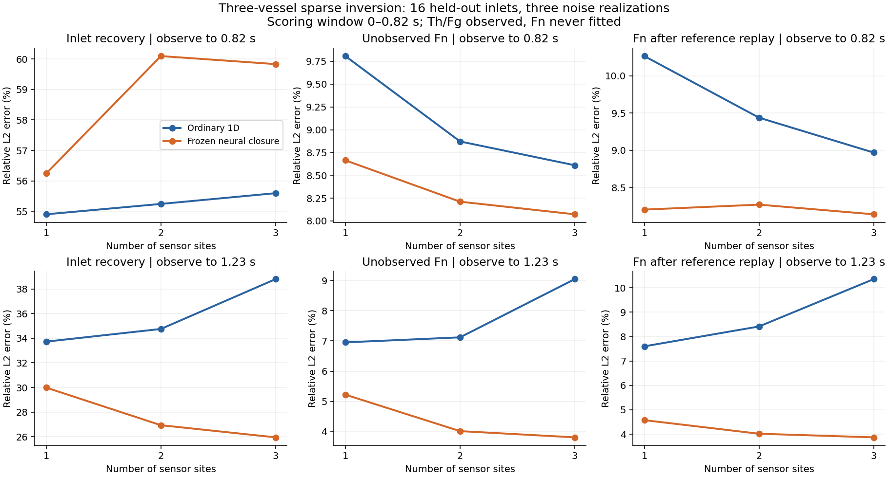
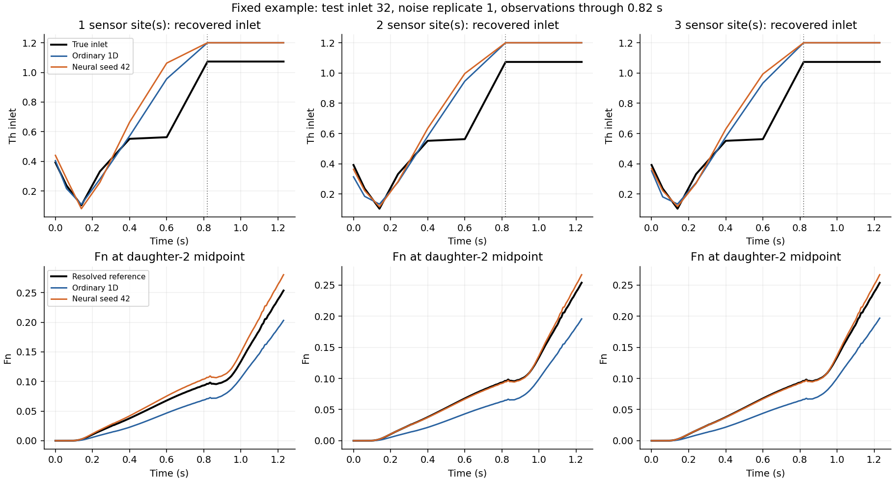
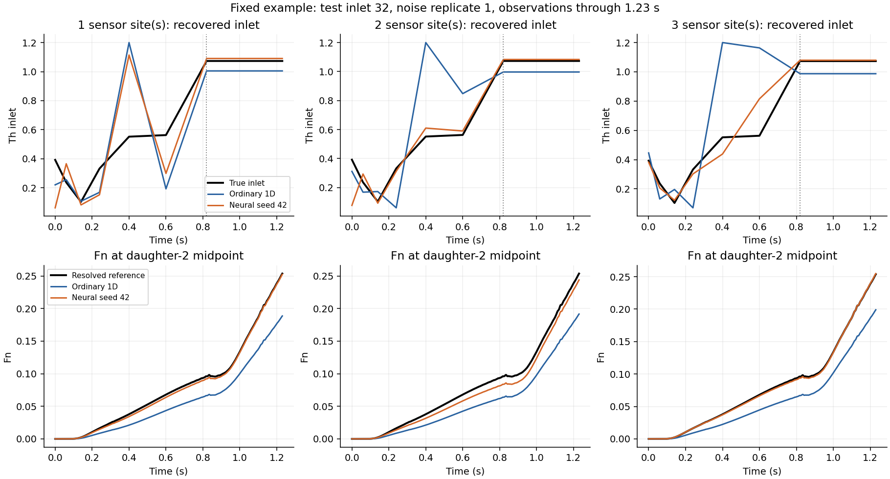

# Three-vessel sparse inlet inversion

The frozen three-vessel model has now been evaluated on one, two and three
sensor sites, against the ordinary 1D finite-volume model. No weights were
retrained. With the longer observation window, the neural model has lower
mean inlet and Fn errors in all three layouts. With the original short window,
its Fn advantage does not imply more accurate inlet recovery.

## What is measured and what is predicted
At each sensor, observe Th and Fg at 24 times. Infer seven Th inlet amplitudes.
Fn is never supplied to the inverse solver. After inference, predict Fn over
all 57 axial cells. The one-site layout observes the parent midpoint (30 mm);
two sites add daughter 1 midpoint (10 mm); three add daughter 2 midpoint (17 mm).

The inlet varies on seven knots from 0 to 0.82 s and then stays at its final
concentration. The reference and predictions extend to 1.23 s. An observation
end of 0.82 s stops acquisition while the last input change is still weakly
visible downstream; 1.23 s allows another 0.41 s to observe its response.
These are acquisition windows, not two different models. Both contain 24
sample times per species and site, so the longer window has wider time spacing.

## Main comparison: noisy observations
Gaussian noise has absolute standard deviation 0.02 in the normalized
concentration units (not 2% of each instantaneous concentration).
Each table averages 16 held-out inlet cases and three noise realizations.
Neural entries average the errors of three independently frozen model seeds;
they are not predictions from a three-model ensemble.
All three error columns below are scored over **0–0.82 s**.
This is offline inverse reconstruction: the longer acquisition uses later
Th/Fg readings to reconstruct the earlier inlet and unobserved Fn. It is not
a causal forecast made at 0.82 s, and it is not a comparison of equal end times.

### Observe through 0.82 s
| Sites | Inlet: ordinary / neural | Fn: ordinary / neural | Replay Fn: ordinary / neural |
|---|---:|---:|---:|
| 1 | 54.90% / 56.24% | 9.81% / 8.66% | 10.26% / 8.20% |
| 2 | 55.24% / 60.10% | 8.87% / 8.21% | 9.44% / 8.27% |
| 3 | 55.60% / 59.83% | 8.61% / 8.07% | 8.97% / 8.14% |

### Observe through 1.23 s
| Sites | Inlet: ordinary / neural | Fn: ordinary / neural | Replay Fn: ordinary / neural |
|---|---:|---:|---:|
| 1 | 33.72% / 29.99% | 6.95% / 5.22% | 7.60% / 4.57% |
| 2 | 34.75% / 26.94% | 7.12% / 4.02% | 8.41% / 4.02% |
| 3 | 38.80% / 25.95% | 9.04% / 3.81% | 10.35% / 3.87% |

For the longer window, paired neural-minus-ordinary differences are:

| Sites | Inlet difference, percentage points (95% CI) | Fn difference, percentage points (95% CI) |
|---|---:|---:|
| 1 | -3.73 (-8.33, 0.98) | -1.73 (-2.42, -0.98) |
| 2 | -7.81 (-13.14, -2.93) | -3.10 (-4.18, -2.05) |
| 3 | -12.84 (-19.84, -6.46) | -5.23 (-7.69, -3.04) |

Negative values favor the neural model. The one-site inlet interval includes
zero, so its lower mean is not evidence of a reliable inlet-recovery advantage.
The two- and three-site inlet intervals, and all three Fn intervals, favor the
neural model in this test population.

“Replay Fn” takes each recovered inlet and runs the same resolved reference
solver again. Its error therefore measures the consequence of the recovered
boundary condition without the candidate model's forward error. It helps
detect cancellation between an incorrect inlet and an incorrect forward model.

## Noise-free reference observations
Noise-free observations still come from the resolved reference, so the 1D
candidate models retain forward-model discrepancy.

### Observe through 0.82 s
| Sites | Inlet: ordinary / neural | Fn: ordinary / neural | Replay Fn: ordinary / neural |
|---|---:|---:|---:|
| 1 | 45.94% / 55.77% | 7.25% / 6.97% | 7.82% / 6.45% |
| 2 | 52.27% / 60.65% | 7.35% / 7.16% | 8.02% / 7.23% |
| 3 | 53.74% / 61.22% | 7.47% / 7.46% | 7.89% / 7.52% |

### Observe through 1.23 s
| Sites | Inlet: ordinary / neural | Fn: ordinary / neural | Replay Fn: ordinary / neural |
|---|---:|---:|---:|
| 1 | 22.31% / 8.22% | 5.75% / 2.79% | 6.50% / 1.45% |
| 2 | 27.57% / 12.91% | 6.51% / 2.38% | 7.85% / 2.27% |
| 3 | 36.94% / 14.28% | 9.03% / 2.36% | 10.27% / 2.36% |

## Why observation duration matters
The Th observation operator is affine in inlet amplitudes. Its singular values
are recorded in diagnostics.json. For one sensor, the ordinary model's
condition number falls from approximately 23,384 with the short window to
110 with the long window. Neural seed 42 falls from approximately 19,747
to 116. The downstream sensor has very little sensitivity to the last input
knot in the short window. Adding downstream sites does not by itself fix
this missing temporal information.

The long-window same-model, noise-free recovery check reconstructs known
inputs with relative inlet errors below 3e-7 for all models. This verifies
the inversion implementation; it is separate from the harder resolved-reference
test. The remaining reference-test error includes model discrepancy,
measurement noise and weakly observed inlet variations. A smaller Fn error
does not establish an accurate recovered inlet, so both are reported.

Regularization was selected separately for each observation window using
validation cases 24–31 only: 0.0001 for the short window and 0 for the long
window. The same value is used by both model families within each window.
Candidate values were 0, 0.0001 and 0.01. The scores give equal weight to
the ordinary and neural model families, with neural seeds averaged first.
Validation scores for every candidate are included in the selection files.

## Fairness and numerical verification
- Same Sen-derived, conservatively projected blood field, 30/10/17 axial cells,
  dt=0.002 s, reaction parameters, initial state and boundary conditions.
- Same sensor sites, time samples, stored noise draws, seven input parameters,
  bounds [0,1.2], observation weights and second-difference prior.
- Three starts: bounded linear Th fit, constant 0.3 and constant 0.9.
  Select the smallest observation/prior objective, never the true-input error.
- Both solvers use the same batched constrained Gauss–Newton/LM search and
  line search. Final double-precision solves allow at most 100 iterations
  per start and target projected gradient 1e-8.
- Float32 FV acceleration was first checked against all 48 saved CPU forward
  runs and four new random inputs. Final tables use double-precision FV,
  while the frozen neural head retains its original float32 weights.
- Final GPU/CPU concentration discrepancies and all optimization termination
  states are retained. Across 1536 final selected fits, maximum projected
  gradient is 2.27e-07; 144 exceed 1e-8 and 0 exceed 1e-6.
  No selected fit or failed start is removed.
- All 1536 final recovered inputs were independently replayed on the
  resolved reference (120/40/68 axial cells, 24 radial rings, dt=0.001 s).
  Maximum normalized mass-balance residual is 2.91e-14.
- 18 protected source, report and weight files have identical
  SHA256 hashes before and after this extension.

## Uncertainty and scope
paired-comparisons.csv contains case-clustered 95% bootstrap intervals for
neural-minus-ordinary errors, with noise realizations and neural seeds averaged
within each of the 16 independent test inlets. Negative differences favor the
neural model. Seed-specific results, full 0–1.23 s errors and every individual
case are in summary.json and per-case.csv. An average advantage does not mean
every individual inlet is improved.

This is one synthetic, fixed-geometry, fixed-blood three-vessel experiment.
Th/Fg/Fn are generated by reaction–transport equations, not mouse biochemical
measurements. The reference resolves axisymmetric prescribed-flow transport
inside three tubes connected by a perfectly mixed junction. It is not 3D
bifurcation Navier–Stokes CFD. The candidate models remain strictly 1D; radial
rings are used only in the independent reference.

The ordinary baseline is the same conservative 1D FV solver with mean-product
reaction and no learned closure. The forward report additionally contains its
mesh-refined and fixed-physics closure comparisons. This inverse report does
not establish superiority over every possible calibrated 1D closure.

## GPU work and runtime
The repeated FV rollouts use fused CUDA kernels; reaction-head evaluation and
candidate inputs are batched on the RTX 5090. No retraining was needed.
Both candidates use the same GPU backend. Final solve times for 192 inverse
problems per method (three starts each), excluding setup, file writing and
reference replays, are:

- Observation end 0.82 s: ordinary_1d 5.24 s, neural_42 22.30 s, neural_43 24.67 s, neural_44 23.56 s.
- Observation end 1.23 s: ordinary_1d 6.66 s, neural_42 23.68 s, neural_43 23.48 s, neural_44 21.91 s.

These are recorded workload times, not a standalone latency benchmark.
The neural solver adds a predictor/corrector and graph-head evaluation, so an
accuracy advantage does not imply a speed advantage. GPU sampling, memory and
power measurements are included in verification.json. The resolved reference
uses the unchanged sparse CPU solver.

## Fixed examples
The examples use the first held-out inlet (32), first noise realization and
neural seed 42, with no selection for favorable appearance.

## Reproduction
See ../../docs/THREE_VESSEL_INVERSE_README.md for the full command sequence.
Existing final weights, earlier single-vessel work and the three-vessel forward
report are unchanged. New raw runs are under runs/inverse-three; final
double-precision results are in each observation window's precision folder.
