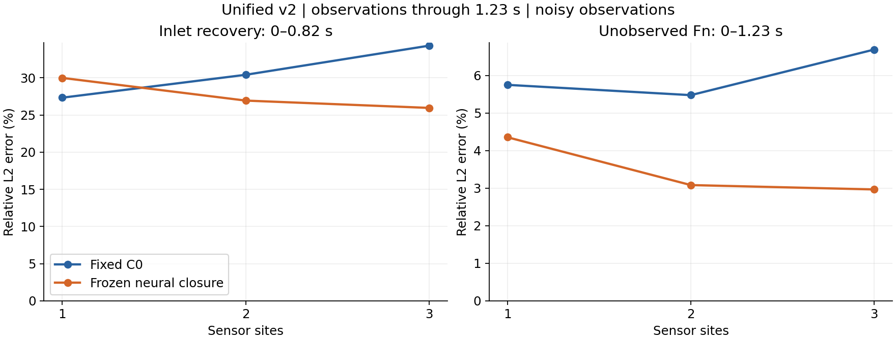
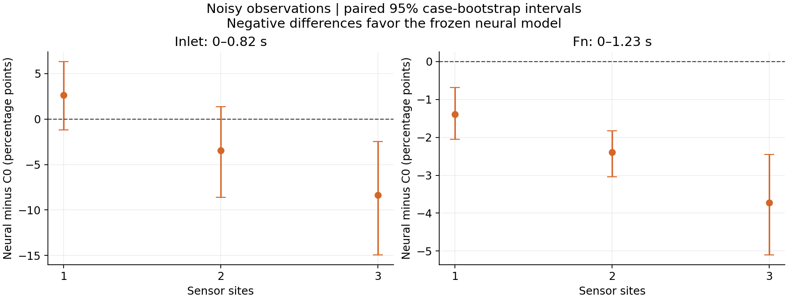
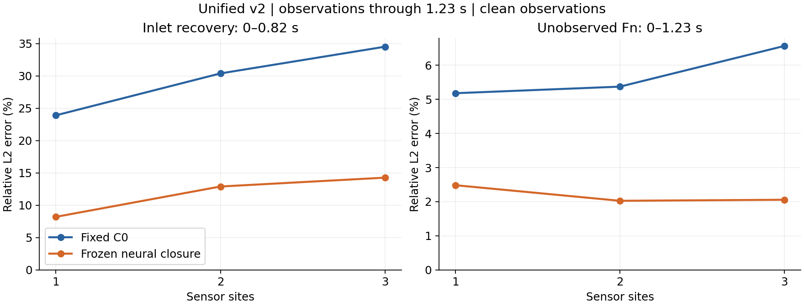

# Unified three-vessel inverse report — v2

This report uses one observation window and one fixed numerical baseline.
Both candidates observe Th/Fg through **1.23 s**. Inlet recovery is scored over
**0–0.82 s**; unobserved Fn is scored over the complete **0–1.23 s** interval.
The seven inlet knots, saved inverse solutions, C0 implementation and all
neural weights are unchanged. Only metrics and presentation are recomputed.

## Fixed comparison

- Baseline: **three-c0-fv-v1**, ordinary conservative 1D finite volume, molecular
  diffusion and mean-product reaction, with no learned closure.
- Neural candidate: the frozen three-vessel transport/reaction closures from
  seeds 42, 43 and 44, using the same conservative numerical framework.
- Same blood, geometry, grid, time step, chemistry, boundaries, observations,
  noise draws, inlet parameterization, bounds and optimization budget.
- One site: parent midpoint (30 mm). Two sites: add daughter 1 midpoint
  (10 mm). Three sites: add daughter 2 midpoint (17 mm).
- 24 observations per species and site, from 0.002 through 1.23 s. Fn is never
  an inverse measurement.
- Inlet varies at seven prescribed knots through 0.82 s, then holds its last value.
- Existing validation-only choices are retained: regularization 0.0001 for C0
  and 0 for all neural seeds, from the same three-value grid. No parameter is
  selected again using these test results.

The reference resolves prescribed-flow axisymmetric reaction–transport in
three connected tubes with a perfectly mixed junction. It is a synthetic
numerical reference, not measured biochemistry or full 3D bifurcation CFD.

## Primary results: noisy observations

Each mean uses 16 test inlet cases and three independent noise realizations,
with Gaussian absolute standard deviation 0.02. Neural values average the
errors of the three frozen models; they are not ensemble predictions.

| Sites | C0 inlet, 0–0.82 s | Neural inlet, 0–0.82 s | C0 Fn, 0–1.23 s | Neural Fn, 0–1.23 s |
|---|---:|---:|---:|---:|
| 1 | 27.33% | 29.99% | 5.75% | 4.35% |
| 2 | 30.41% | 26.94% | 5.48% | 3.08% |
| 3 | 34.33% | 25.95% | 6.69% | 2.97% |

The inlet columns still assess the varying part of the input, while the Fn
columns now assess the entire computed response. The old Fn score ending
at 0.82 s must not be substituted into this table.

## Paired uncertainty

Differences are neural minus C0 in percentage points. Negative favors neural.
Noise and neural seeds are averaged within each case before resampling the
16 independent inlet cases 10,000 times.

| Sites | Inlet difference (95% CI), pp | Fn difference (95% CI), pp |
|---|---:|---:|
| 1 | 2.66 (-1.19, 6.33) | -1.39 (-2.06, -0.68) |
| 2 | -3.47 (-8.62, 1.34) | -2.39 (-3.04, -1.83) |
| 3 | -8.37 (-14.95, -2.45) | -3.72 (-5.11, -2.46) |

The noisy-data inlet interval favors neural at sensor counts
3; the full-window Fn interval
favors neural at sensor counts 1, 2, 3.
An interval spanning zero does not establish a reliable advantage.
A lower mean does not mean every individual inlet is improved.

## Clean observations

These observations still come from the resolved reference, so candidate
forward-model discrepancies remain even without measurement noise.

| Sites | C0 inlet, 0–0.82 s | Neural inlet, 0–0.82 s | C0 Fn, 0–1.23 s | Neural Fn, 0–1.23 s |
|---|---:|---:|---:|---:|
| 1 | 23.92% | 8.22% | 5.18% | 2.48% |
| 2 | 30.40% | 12.91% | 5.37% | 2.03% |
| 3 | 34.53% | 14.28% | 6.57% | 2.06% |

## Metric definitions

Let c(t) be the prescribed inlet and c_hat(t) its recovered waveform. Inlet
error is sqrt(sum((c_hat-c)^2) / sum(c^2)), sampled every 0.002 s from 0 to
0.82 s inclusive. The held tail after 0.82 s does not dilute this metric.

Fn error is sqrt(sum(V*(Fn_hat-Fn_ref)^2) / sum(V*Fn_ref^2)), using all 57
physical cells and all samples from 0 through 1.23 s. V is the time-dependent
cell volume. This retains the original equal-time-sample convention; a
constant dt factor cancels in the ratio. Errors are computed per inverse
problem and then averaged, rather than pooling all fields into one ratio.

This is offline inverse reconstruction using all available measurements
through 1.23 s. It is not a causal forecast made at 0.82 s.

## Verification and preservation

- Recomputed **768** selected inverse results:
  16 inlets × 4 noise settings × 3 layouts × 4 candidates.
- Every test case, noisy replicate, model seed and selected fit is retained.
- Maximum absolute difference from the archived per-case metrics:
  inlet 0,
  Fn 6.94e-17.
- Baseline identity and both projects' protected model/source/input hashes
  match the existing lock.
- **67** reused or archived files have identical
  before/after SHA256 hashes. Previous reports and raw inverse runs remain intact.
- No neural training, inference, inverse optimization or validation retuning
  was invoked. Computation consists of reading arrays and recomputing statistics.
- Saved optimizer diagnostics remain visible in per-case.csv. Maximum selected
  projected gradient is 7.97e-08;
  51 exceed the strict 1e-8 target and
  0 exceed 1e-6. No such case is removed.

## What this update establishes

The reporting convention is now consistent across one, two and three sites.
It does not change the model or resolve the previously identified model
discrepancy and regularization limitations. C0 is the fixed basic comparator,
not a claim to be the strongest calibrated numerical closure. Existing test
cases have already been inspected, so this is a re-summary, not a new blind test.
These observations and fits do not demonstrate a speed advantage.

The [v1 report](../three-vessel-inverse/REPORT.md) retains short-window and
historical scoring results. The [method lock](../../docs/FIXED_METHODS.md)
keeps the published single-vessel C1 experiment separate.

## Files and reproduction

- summary.json: clean/noisy means for C0 and every frozen neural seed.
- per-case.csv: all individual errors and original optimization diagnostics.
- paired-comparisons.csv: paired differences, uncertainty and per-case win counts.
- protocol.json: the exact reporting windows and aggregation rules.
- verification.json and manifest.json: integrity and numeric cross-checks.
- validation-selection.json: unchanged validation decisions.

From the existing the experiment host checkout:

~~~bash
OPENBLAS_NUM_THREADS=2 OMP_NUM_THREADS=2 PYTHONPATH=src \
  .venv/bin/python -m gp52.three.unified_report
~~~

See [the v2 protocol](../../docs/THREE_VESSEL_UNIFIED_REPORT_V2.md).
