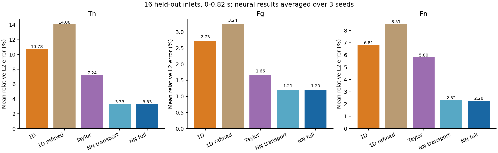
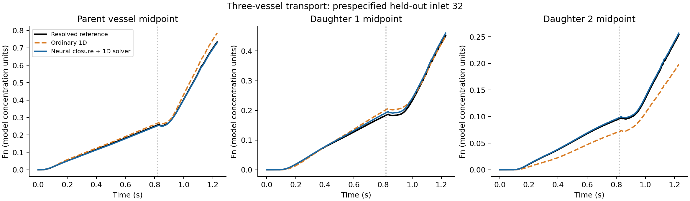
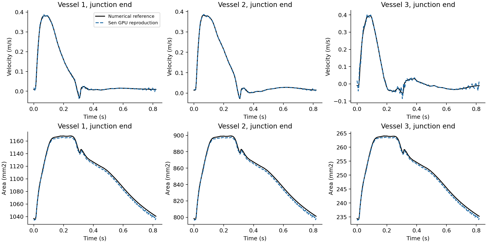

# Three-vessel extension: results and scope

## Completed work
- GPU reproduction of the pinned Sen 2024 three-vessel blood-flow example.
- Strict one-dimensional transport and catalytic Fg-to-Fn reaction on a Y network.
- A zero-volume junction with concentration mixing and exact discrete mass balance.
- Two learned temporal flux-memory variables per internal edge and a graph reaction head.
- Matched-grid ordinary 1D comparison, refined ordinary 1D comparison, two fixed physical dispersion probes, and transport/reaction ablations.
- Three independent biochemical training seeds and 16 held-out chemical inlet waveforms.

The original release, its checkpoints and the prior Sen/CCA experiments are unchanged.
This is a separate experiment; it is not an update to the published final model.

## Main result
| Method | Th | Fg | Fn |
|---|---:|---:|---:|
| Ordinary 1D, matched grid | 10.78% | 2.73% | 6.81% |
| Ordinary 1D, refined | 14.08% | 3.24% | 8.51% |
| Physical single-memory closure | 9.04% | 2.21% | 6.49% |
| Quasi-steady Taylor dispersion | 7.24% | 1.66% | 5.80% |
| Neural transport only | 3.33% | 1.21% | 2.32% |
| Neural reaction only | 10.78% | 2.70% | 6.71% |
| Neural transport + reaction | 3.33% | 1.20% | 2.28% |

Errors are volume/time-weighted relative L2, averaged across held-out inlets, over 0-0.82 s.
Neural rows average seeds 42, 43 and 44. Every seed is retained.
The full neural model improves Th/Fg/Fn on [16, 16, 16] of 16 paired cases (seed-averaged).
The improvement comes predominantly from transport closure. The added Fn improvement from
the reaction head is small and below the reference-refinement differences; it is not a
demonstrated practically significant Fn gain.

The refined ordinary 1D result is worse against the cross-section-resolved reference:
coarse-grid numerical diffusion partially compensates for omitted cross-sectional mixing.
This is not evidence that refinement is mathematically wrong. It distinguishes numerical
discretization error from the model reduction error.

## Blood reproduction
The source is upstream commit bf0ec89f0aab8a639bdd2d363dc3c0cfae770c1d.
The PyTorch port is checked against the original TensorFlow forward pass, loss and all
parameter gradients; discrepancies are approximately 1e-16 in float64.
The architecture, observations and loss are retained. Adam implementation and initialization
differ across frameworks. Training uses 100,000 scheduled updates plus four warm-up/capture
updates, for each of 32 random initializations. Selection uses only the training objective.
Elapsed training time: 179.06 s. Mean GPU utilization: 99.44%.

Velocity errors at the three observed boundaries are below 0.1%. Errors at unobserved
recorded positions range from about 0.75% to 7.37%, with the largest at the smaller daughter
inlet. Area relative errors are about 0.25%-0.31%. The raw junction flow mismatch is
0.0402% relative L2. All positions are in summary.json.

The original upstream three-vessel graph uses identical distal labels for both daughter
vessels. Its graph therefore contains a distal shortcut. That original graph is retained
for reproduction only. The biochemical Y network uses distinct distal outlets.

## What the reference is
Blood is the selected Sen prediction, explicitly projected onto discrete local volume
conservation and junction flow conservation. The flow correction is about 5.3%-5.5% in
relative L2 (depending on grid/time discretization), and is shared by all biochemical methods.
Raw Sen predictions are saved separately. This benchmark does not claim that the unprojected
network output is exactly conservative.

The biochemical reference resolves axial and radial concentration variation in each tube,
with a prescribed parabolic axial velocity profile and continuity-compatible radial flux.
The three tubes meet at a perfectly mixed, zero-volume junction. It is a resolved
advection-diffusion-reaction reference, NOT a full three-dimensional bifurcation Navier-Stokes
CFD simulation. It cannot validate vortex mixing in a real bifurcation.

Final reference: 120/40/68 axial cells, 24 radial cells, dt=0.001 s.
Reduced models: 30/10/17 axial cells, no radial concentration cells, dt=0.002 s.
Additional reference check: 240/80/136 axial cells, 32 radial cells, dt=0.0005 s,
on prespecified cases 0 and 32. Volume-weighted full-window Fn differences are
0.274% and
0.194%. The method ranking remains
unchanged for the checked held-out case.

## Data, chemistry and training
Only the seven control amplitudes of the chemical inlet are sampled randomly, from
[0.05,1.15], using seed 2026102801. Th/Fg/Fn fields are computed from physical transport
and reaction equations, not sampled independently.
There are 24 training, 8 validation and 16 test inlet curves.
Initial Th is a Gaussian in the parent vessel, initial Fg is 1, and initial Fn is 0.
The upstream reservoir supplies the sampled Th and Fg=1. Distal inflow reservoirs have
Th=0 and Fg=1. Diffusivity is 2e-4 m2/s; reaction rate is 2*Th*Fg; Fn is immobile.
These are synthetic verification settings, not calibrated mouse coagulation parameters.

Transport is trained on the cross-sectional advective covariance flux.
Reaction is trained on the cross-sectional physical reaction source.
No joint trajectory fitting is used to hide transport error in reaction coefficients.
Validation physical-moment errors select checkpoints. Test cases never select checkpoints.
The source error on true test concentration fields decreases from 0.620% for the
mean-product source to 0.305% for the learned source. Its small absolute size explains
the limited incremental Fn effect.

The two memory variables are temporal flux states, not radial concentration subdivisions.
The architecture retains graph closure learning and conservative one-dimensional solving;
the edge graph and physical time scaling are adapted to the Y network.
This is a retrained extension, not a zero-shot application of the original weights.

## Conservation and performance
Maximum normalized Fg+Fn mass-balance residual across the ordinary/full neural rollouts:
2.581e-15. No negative concentration was found in these rollouts.
The uniform-concentration test passes to machine precision.
Three concurrent GPU closure fits used mean utilization approximately
97.9%, with peak 100%.

The neural method still advances a numerical 1D solver, and its extra memory/corrector work
has a cost. No inference-speed superiority over ordinary 1D is claimed.
Reference generation uses sparse CPU factorization; neural training uses the RTX 5090.

## Remaining scope
- This tests new chemical inlet curves on one three-vessel geometry and blood condition.
  It does not establish cross-geometry or cross-blood generalization.
- It does not use the real mouse In_Vivo data.
- Three-vessel sparse biochemical inversion and seven-vessel extension are not included.
- Independent real biochemical measurements and true three-dimensional junction CFD are absent.
- The graph's independent benefit has not been isolated by a three-vessel equal-parameter
  no-graph ablation; the reported gain is for the complete learned closure.
- The improved biochemical result is conditional on the supplied projected Sen blood field;
  it is not an independent validation of physiological blood/coagulation prediction.

See docs/THREE_VESSEL_PROTOCOL.md and docs/THREE_VESSEL_README.md for exact scope and commands.
